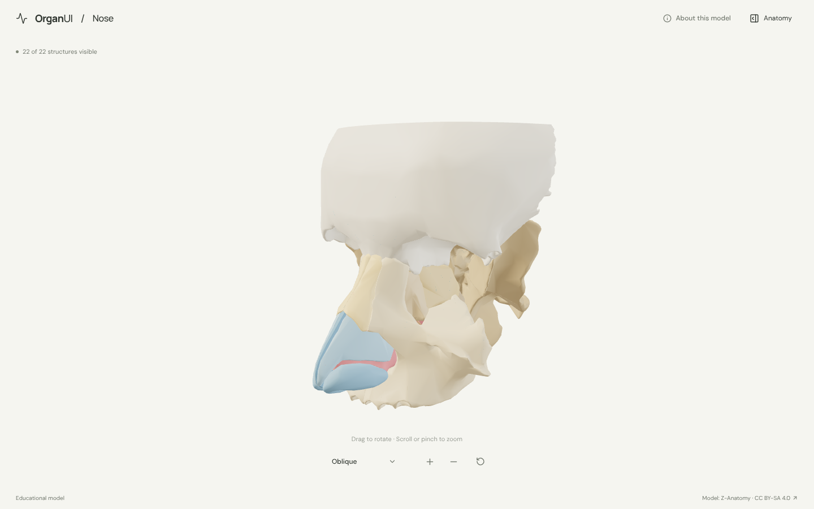
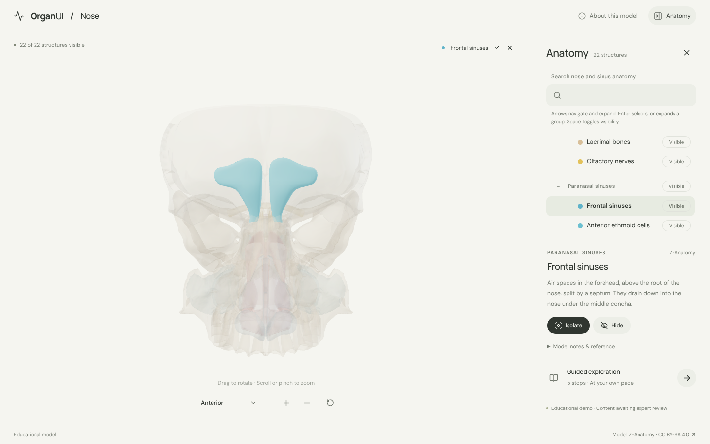
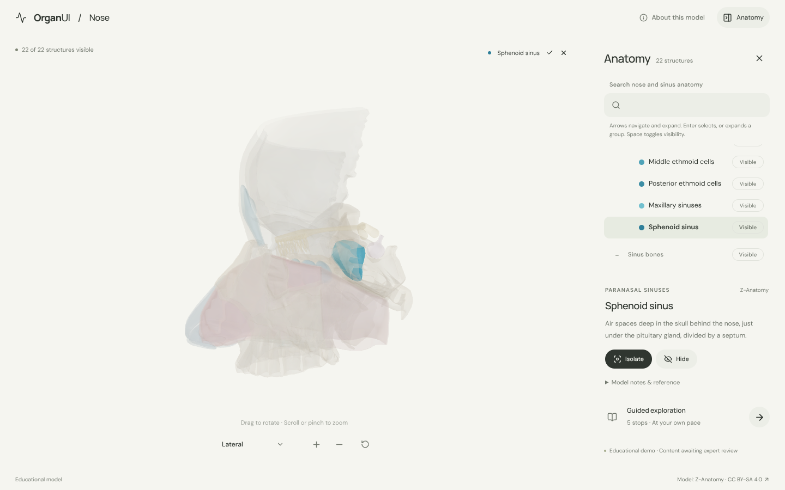
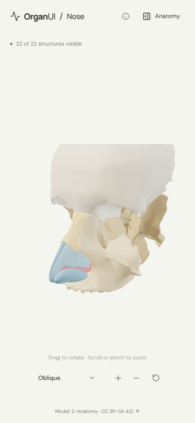

# OrganUI Nose

A minimal, standalone, open-source explorer for the human nose and paranasal sinuses, built with React, TypeScript, Three.js, React Three Fiber, Vite, and Bun. It shares its interaction design and code with [OrganUI Heart](https://github.com/organui/heart-3d).

**Status:** working local demo. Twenty-two selectable structures from a real, openly licensed model (one of them, the maxillary sinus, an illustrative shape carved from it), responsive layouts, and checked desktop/mobile interactions. Public deployment and clinical anatomy review have not been completed.



## Run locally

Install [Bun](https://bun.sh/) **1.4.2 or newer**, then:

```sh
git clone https://github.com/organui/nose-3d.git
cd nose-3d
bun install --frozen-lockfile
bun run dev
```

Open **http://127.0.0.1:5173**. No environment variables, accounts, API keys, sibling repositories, model downloads, or external font services are needed after dependency installation. The ready-to-use 3.8 MB GLB is in `public/models/`.

```sh
bun run typecheck       # TypeScript checks, including conversion scripts
bun run test            # Unit tests for selection emphasis, picking, ownership, sinus recipes, and the anatomy-tree adapter
bun run verify:model    # Check the GLB hash, source IDs, element lists, and valid geometry
bun run build           # Typecheck and create dist/
bun run preview         # Serve the production build at http://127.0.0.1:4173
bun run format:check    # Check formatting
```

The app is static and uses relative build paths. No deployment has been performed.

## Explore

- The nose opens in an oblique view with the bones of the face around it. Open **Anatomy** in the header to browse structures in six groups: external nose, nasal septum, nasal cavity, paranasal sinuses, the bones that hold them, and the pituitary gland and nasopharynx nearby.
- Drag to rotate; scroll or pinch to zoom. The view menu has anterior, oblique and lateral presets. Manual rotation changes its label to **Custom view**; zooming and selecting keep the view name.
- Select a mesh or use the anatomy tree (the OrganUI registry `anatomy-tree` component, see [registry integration](docs/REGISTRY_INTEGRATION.md)). The selected structure glows in its own colour and everything else is ghosted, so the sinuses, the septum and the lining of the nasal cavity show through the bone around them.
- Isolate a structure, hide it, or restore all. **Reset explorer** restores the oblique camera, visibility, selection, tree state and tour.
- Follow five guided stops: the bony and cartilaginous nose, the septum, the airway, the frontal sinuses and the sphenoid sinus.
- Keyboard: Tab/Enter for controls, arrow keys to rotate the focused model, `+`/`-` to zoom, Escape closes the panel and returns focus to its toggle.

<details>
<summary>Sinus selection, left lateral view and mobile screenshots</summary>







</details>

## Model, credits, and license

> Z-Anatomy (CC BY-SA 4.0), based in part on BodyParts3D / Anatomography, © The Database Center for Life Science (DBCLS). Adapted by OrganUI.

The model is a curated subset of **[Z-Anatomy](https://github.com/LluisV/Z-Anatomy)**: 33 source objects grouped into 21 structures, plus an **illustrative maxillary sinus** that [`scripts/sinuses.ts`](scripts/sinuses.ts) carves from inside the maxillae because the source has none; the app labels it as such. Z-Anatomy was chosen over BodyParts3D because it has real frontal, ethmoid and sphenoid sinus meshes and a lining of the nasal cavity. The model data and screenshots of it are under **[CC BY-SA 4.0](https://creativecommons.org/licenses/by-sa/4.0/)**, separately from this repository's **MIT code license**. Source files are pinned to a commit and checked by SHA-256. Read [model provenance](docs/MODEL_PROVENANCE.md), [asset attribution](public/models/ATTRIBUTION.md) and the [manifest](public/models/manifest.json).

Descriptions summarise general anatomy; the reference link points to the [NCI SEER Training sinus anatomy page](https://training.seer.cancer.gov/head-neck/anatomy/sinuses.html). **Expert anatomical review is pending.** This is an educational interface demonstration, not a diagnostic or clinical tool.

Known limitations:

- The maxillary sinus is an approximation, not segmented from a scan, and smaller than a typical adult sinus. The source sphenoid sinus is low in detail.
- Skin, soft tissue, the minor alar cartilages, nasal muscles, vessels, teeth and the rest of the skull are omitted. The frontal bone is cut about 5 cm above the root of the nose. The perpendicular plate of the septum is part of the ethmoid mesh.
- Left and right structures are grouped into one selectable pair each. Colours are illustrative.
- Browser checks used headless Chromium with software WebGL at desktop and phone viewport sizes, not physical devices or a screen-reader audit.

## License

Original application code: [MIT](LICENSE). Anatomy model, derived model images, fonts, and icons retain their separately documented licenses.

Part of [OrganUI](https://github.com/organui).
